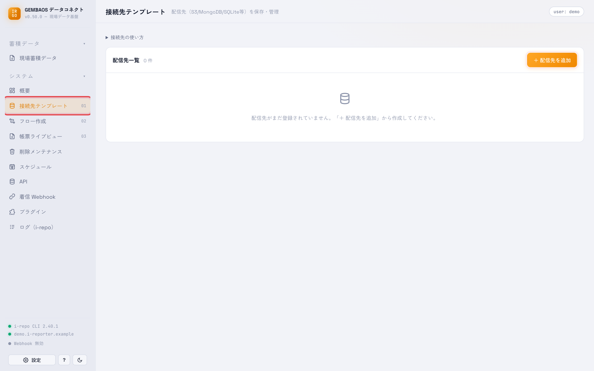
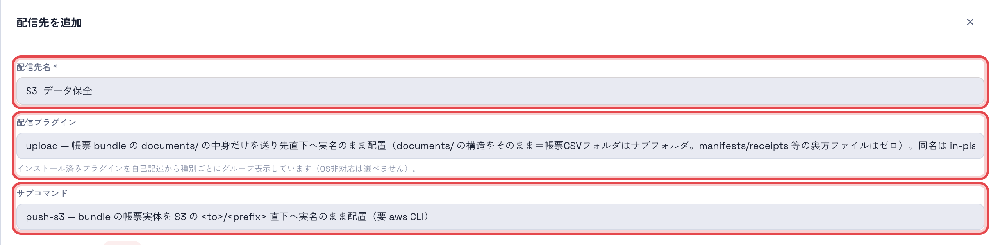
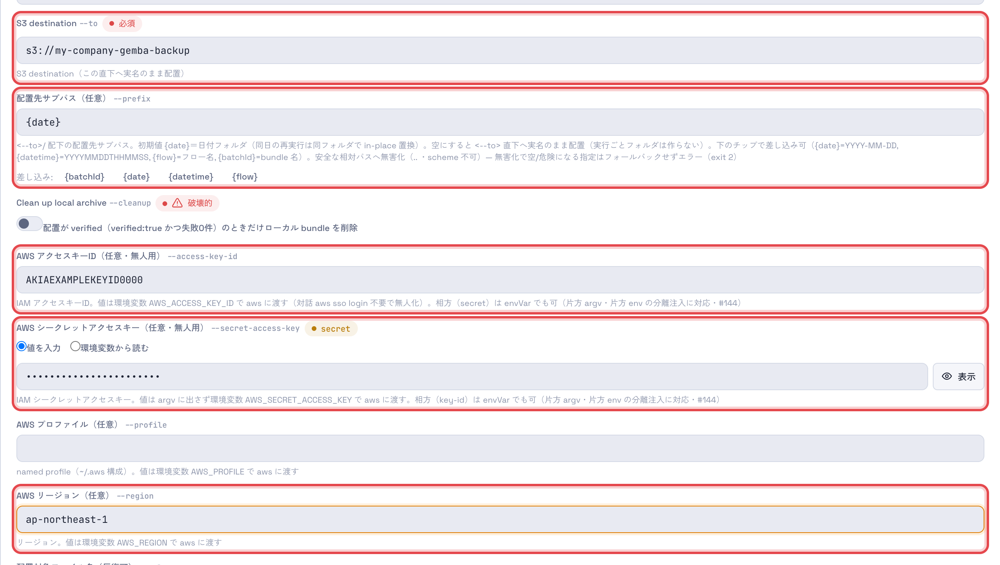
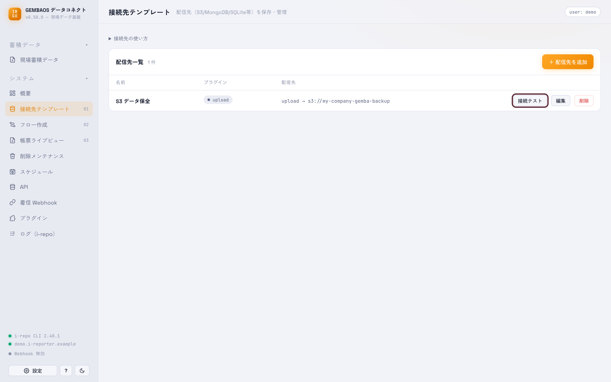
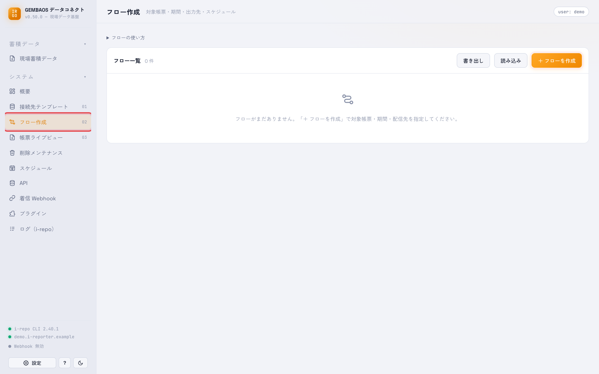
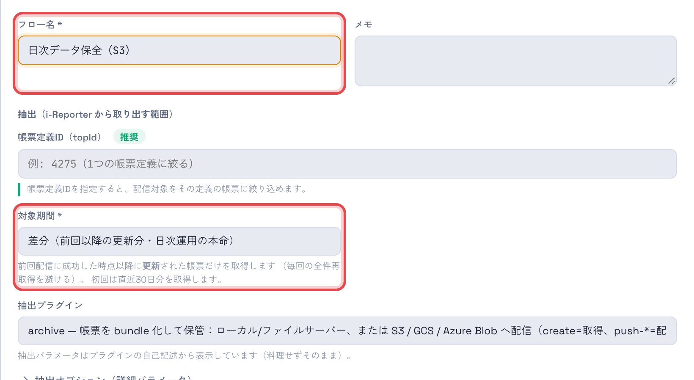
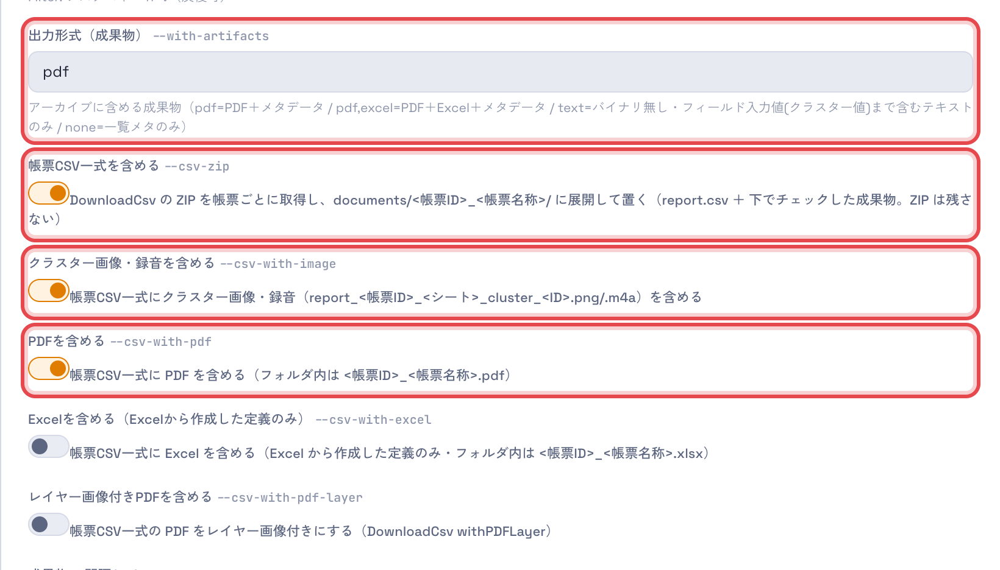
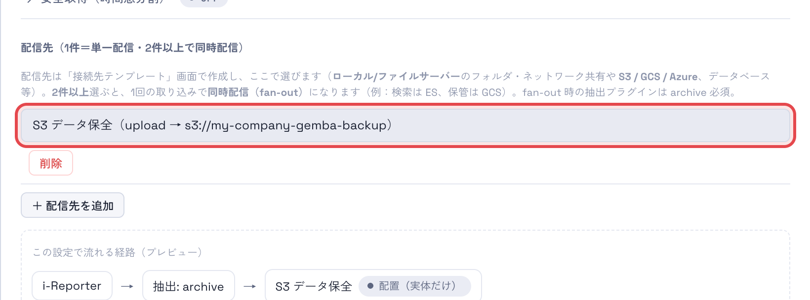
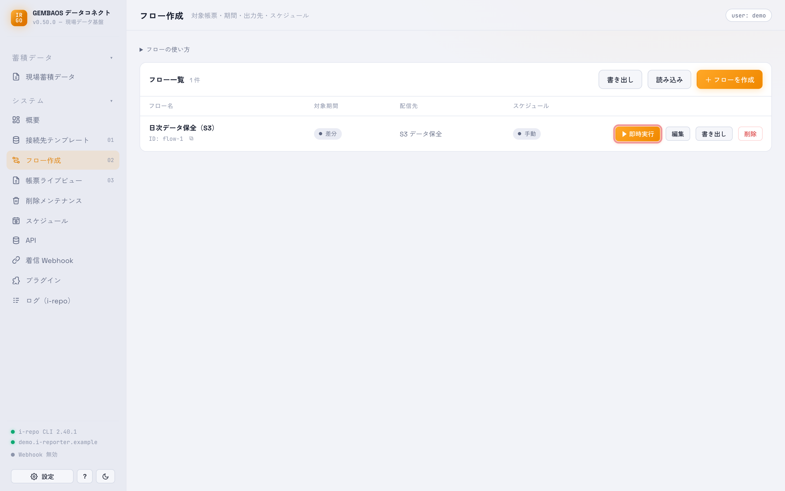
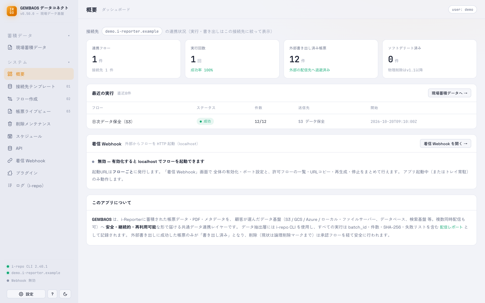

# データ保全をはじめる（Amazon S3）

i-Reporter の帳票を、毎日 **Amazon S3** に保全するいちばん簡単な手順です。
**GEMBAOS データコネクト**（v0.50.0 以降）で、「送り先を登録する → フローを作る → 実行する」の 3 ステップで終わります。

保全が終わると、S3 には帳票ごとに次のように並びます（日付フォルダの中に、帳票 1 件につき PDF とフォルダが 1 つずつ）。

```
s3://<バケット名>/
└─ 2026-10-20/
   ├─ 27389_不具合報告&品質対策シート.pdf          … 帳票の PDF
   └─ 27389_不具合報告&品質対策シート/
      ├─ report.csv                               … 帳票の入力値（CSV）
      ├─ report_27389_1_cluster_5.png             … 撮影した写真（ある帳票だけ）
      └─ 27389_不具合報告&品質対策シート.pdf       … 同じ PDF（フォルダだけで完結させるため）
```

名前は「帳票ID_帳票名称」です。`report.csv` の中では写真を `27389_1_cluster_5.png` のような名前で参照しているので、
フォルダの中のファイル名は変えずにそのまま使ってください。

---

## 準備するもの

| もの | 内容 |
|---|---|
| アプリ | **GEMBAOS データコネクト v0.50.0 以降**（[ダウンロード](https://github.com/i-repo-community/i-repo-gemba-os-releases/releases/latest)）。i-Reporter への接続設定まで済んでいること（[初回セットアップ](manual-setup.html)） |
| AWS CLI | S3 へのアップロードに使います。[AWS CLI v2](https://docs.aws.amazon.com/cli/latest/userguide/getting-started-install.html) を入れておいてください |
| S3 バケット | 保全先のバケット（例 `my-company-gemba-backup`）と、そのリージョン（例 `ap-northeast-1`） |
| アクセスキー | そのバケットに書き込める IAM ユーザーの **アクセスキー ID** と **シークレットアクセスキー**。権限は対象バケットへの `s3:PutObject`（書き込み）と `s3:ListBucket`（書き込み後の確認）があれば足ります |

> アクセスキーは、社内の AWS 管理者に発行してもらってください。シークレットアクセスキーは画面上で伏せ字になり、アップロードのときに AWS CLI へ渡すだけです。

---

## 手順 1. 送り先（S3）を登録する

**① 左のメニューの「接続先テンプレート」を開き、右上の「＋ 配信先を追加」を押します。**

<figure class="screenshot">
  
  <figcaption>接続先テンプレート → 「＋ 配信先を追加」</figcaption>
</figure>

**② 名前を付けて、送り方を選びます。**

- **配信先名**: 分かりやすい名前（例「S3 データ保全」）
- **配信プラグイン**: `upload`（帳票のファイルを、そのままの名前で置く）
- **サブコマンド**: `push-s3`

<figure class="screenshot">
  
  <figcaption>配信プラグインは <b>upload</b>、サブコマンドは <b>push-s3</b></figcaption>
</figure>

**③ S3 の情報を入れます。**

- **S3 destination**: `s3://` に続けてバケット名（例 `s3://my-company-gemba-backup`）
- **配置先サブパス**: 最初から `{date}` が入っています。このままにすると、**実行した日の日付フォルダ**（例 `2026-10-20/`）に置かれます
- **AWS アクセスキーID** / **AWS シークレットアクセスキー**: 準備したアクセスキー
- **AWS リージョン**: バケットのリージョン（例 `ap-northeast-1`）

<figure class="screenshot">
  
  <figcaption>赤枠の項目を入れます（ほかの項目は空のままで構いません）</figcaption>
</figure>

入れ終わったら、右下の **「保存」** を押します。一覧に追加されれば完了です。

<figure class="screenshot">
  
  <figcaption>「接続テスト」で、アップロードに使う AWS CLI が入っているかを確かめられます（キーやバケットへの接続までは確かめません）</figcaption>
</figure>

---

## 手順 2. フローを作る

フローは「どの帳票を・どこへ送るか」の設定です。

**① 左のメニューの「フロー作成」を開き、右上の「＋ フローを作成」を押します。**

<figure class="screenshot">
  
  <figcaption>フロー作成 → 「＋ フローを作成」</figcaption>
</figure>

**② フロー名と対象期間を決めます。**

- **フロー名**: 例「日次データ保全（S3）」
- **対象期間**: **「差分（前回以降の更新分）」** を選びます。前回うまく送れた時点より後に更新された帳票だけを取り出すので、
  あとから直した帳票も拾え、送れなかった日の分も次の実行でまとめて取り込めます（初回は直近 30 日分）
- **帳票定義ID**: 空欄なら全部の帳票定義が対象です。特定の帳票だけにしたいときに入れます

<figure class="screenshot">
  
  <figcaption>フロー名を付け、対象期間を選びます</figcaption>
</figure>

**③ 「抽出オプション（詳細パラメータ）」を開き、取り出すものを選びます。**

- **出力形式（成果物）**: `pdf` のまま（バケット直下に帳票の PDF を置きます）
- **帳票CSV一式を含める**: オン（帳票ごとのフォルダに `report.csv` を置きます）
- **クラスター画像・録音を含める**: オン（写真や録音もフォルダに入れます）
- **PDFを含める**: オン（フォルダの中にも PDF を入れます）

<figure class="screenshot">
  
  <figcaption>「帳票CSV一式を含める」をオンにすると、その下の選択肢が出ます。Excel から作った帳票定義なら「Excelを含める」も選べます</figcaption>
</figure>

**④ 「配信先」の「＋ 配信先を追加」を押し、手順 1 で登録した「S3 データ保全」を選びます。**

<figure class="screenshot">
  
  <figcaption>下の「この設定で流れる経路」が <b>i-Reporter → 抽出 → S3 データ保全</b> になっていれば正しく選べています</figcaption>
</figure>

右下の **「保存」** を押します。

---

## 手順 3. 実行して確かめる

**① フロー一覧の「▶ 即時実行」を押します。**

<figure class="screenshot">
  
  <figcaption>まずは手動で 1 回動かしてみます</figcaption>
</figure>

**② 「概要」の「最近の実行」で結果を見ます。** ステータスが **「成功」** になり、件数が「12/12」のように揃っていれば、全件が S3 に置かれています。

<figure class="screenshot">
  
  <figcaption>「成功」は、S3 に置いたあとにファイルの有無と大きさまで照合して確かめた結果です</figcaption>
</figure>

**③ S3 を開くと**、このページの最初に示した形で、日付フォルダの中に帳票の PDF とフォルダが並んでいます。

うまくいかないときは、左のメニューの「ログ（i-repo）」に詳しい理由が出ます。
よくある原因は、AWS CLI が入っていない・アクセスキーの組み合わせ違い・リージョン違い・書き込み権限不足です。

---

## 毎日自動で動かす

1. フローの編集画面で **「実行条件」** を開き、「毎日」と時刻を選んで保存します
2. 同じ編集画面の **「着信 Webhook」** を有効にします（定期実行はこの入口から動きます）
3. 左のメニューの **「スケジュール」** で、このフローのカードの **「登録」** を押します（保存しただけでは登録されません）

OS のスケジューラに登録されるので、アプリを最小化していても（常駐していれば）決まった時刻に動きます。
対象期間を「差分」にしてあるので、パソコンの電源が切れていた日の分も、次に動いたときにまとめて取り込めます。
詳しくは [スケジュールの画面](screen-scheduler.html) を見てください。

---

## よくある質問

**同じ日にもう一度実行したら？**
同じ日付フォルダの同じ名前のファイルが、新しい内容で置き換わります。フォルダやファイルが重複して増えることはありません
（バケットのバージョニングが有効なら、前の版も S3 側に残ります）。

**日付フォルダを使わず、バケットの直下に置きたい**
手順 1-③ の「配置先サブパス」を空にします。実行ごとに分けたいときは `{datetime}`（例 `20261020T091530/`）を入れます。

**`report.csv` が文字化けする**
i-Reporter が出力したままの文字コード（Shift_JIS）で置いています。Excel ではそのまま開けます。
ほかのツールで読むときは、文字コードに Shift_JIS（CP932）を指定してください。

**写真が入っていない帳票がある**
写真や録音のクラスターに入力がある帳票だけ、フォルダに画像が入ります。

**PDF をフォルダの中だけにしたい**
手順 2-③ の「出力形式（成果物）」を `none` にすると、バケット直下の PDF は作られず、帳票フォルダだけになります。
